# 개요

개발을 진행하면서 개발 생산성 & 빌드 성능 개선했던 사례들을 공유하려고 합니다.

# Lint 속도 개선

husky를 통해서 Lint 검사에 대한 속도 개선을 위해서 eslint, prettier cache 적용하였습니다.
cache flag 적용 시 이전에 검사했던 파일이나 항목을 cache에 저장하여 변경사항이 없다면 그 파일은 검사하지 않도록 처리가 가능합니다.

- eslint —cache
  ```json
  "lint-staged": {
    "src/**/*.{js,jsx,ts,tsx}": [
      "eslint --cache --max-warnings=0 --fix src"
    ],
  },
  "husky": {
    "hooks": {
      "pre-commit": "lint-staged"
    }
  },
  ```
- prettier —cache
  ```json
  "lint-staged": {
    "src/**/*.{js,jsx,ts,tsx}": [
      "prettier --cache --write src"
    ],
  },
  "husky": {
    "hooks": {
      "pre-commit": "lint-staged"
    }
  },
  ```

# 빌드 용량 개선

## [Tree Shaking](https://seungahhong.github.io/blog/2023/08/2023-08-16-treeshaking/)

- **Tree Shaking 설명 전 모듈 기초 지식**

  - javascript에 모듈 관리 스팩이 없었던 때, 문제 발생

          - 관리가 어려움 - **script 태그로 파일을 로드**하려면, 일일이 추가해야 하고,
          - 수많은 코드 모듈 중에 **전역변수가 오버라이드** 되는 경우도 발생

    - 문제를 해결하기 위한 방법도 중구난방 - 그래서 특정 라이브러리들은 자기만의 **모듈 객체를 만들어 씀 $**, \_

    - **IIFE로 감싸서** 파일을 만드는 것도, 보기 불편…

  - CommonJS, AMD, UMD, ESM 등이 등장

    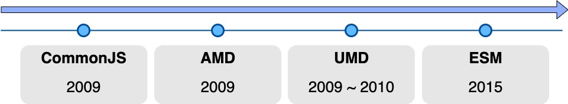

  - CommonJS - 2009년

    - 2005 ~ 2009년, J-Query/AJAX 탄생으로 클라이언트만이 아닌 **서버 사이드 동작**
    - 로컬 파일을 불러오는 방식으로 사용하기 위해서 **모듈 로더가 동기적으로 작동**

    - **파일 시스템에 직접 접근, 필요한 모듈이나 데이터를 로컬에서 빠르게 로드**가능

      - **비동기로 동작하는 브라우저 환경에 사용하기에는 무리**

    - **네트워크를 통해 모듈이나 라이브러리를 로드** **→ 로딩 시간 증가**

      ```tsx
      // test.js
      module.exports = 'hi';
      // index.js
      const Hi = require('./test.js');
      ```

      - **exports, require 다른 메모리 주소를 바라본다.**
        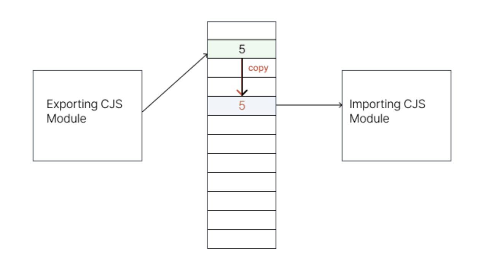
        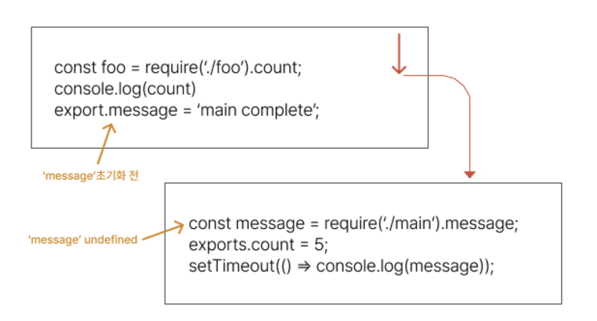

  - AMD(Asynchronous Module Definition) - 2009년

    - 2009, **브라우저 환경을 위한 브라우저 모듈의 표준 지정**
    - **모듈과 의존성을 비동기적으로 로드하는 방법을 정의하는 개방형 표준**
    - 표준 지정 후 가장 널리 채택된 라이브러리 **RequireJS**

      ```tsx
      define(['dep1', 'dep2'], function (dep1, dep2) {
        //Define the module value by returning a value.
        return function () {};
      });
      /_ RequireJS _/;
      // messages.js
      define(function () {
        return {
          getHello: function () {
            return 'Hello World';
          },
        };
      });
      // main.js
      define(function (require) {
        // Load any app-specific modules
        // with a relative require call,
        // like:
        var messages = require('./messages');
        // Load library/vendor modules using
        // full IDs, like:
        var print = require('print');
        print(messages.getHello());
      });
      ```

    - UMD (Universal Module Difinition) - 2010년 - **CommonJS / AMD 모듈 시스템을 모두 지원해야 하는 상황에서 나온 패턴**

    ```tsx
    (function (root, factory) {
      if (typeof define === 'function' && define.amd) {
        // AMD
        define([], factory);
      } else if (typeof module === 'object' && module.exports) {
        // CommonJS
        module.exports = factory();
      } else {
        // browser
        root.isDev = factory();
      }
    })(this, function () {
      return process.env.NODE_ENV === 'development';
    });
    ```

    - ESM (esmodule) - 2015년

      - **import, export 구문을 사용해 모듈을 명확히 정의 → 최상위 레벨에만 위치**
      - **각 모듈 간 명확한 의존성 파악**

        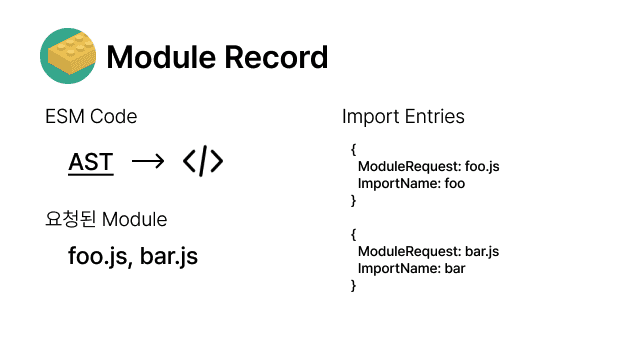

      - **import, export 동일한 메모리 주소를 바라본다.**
        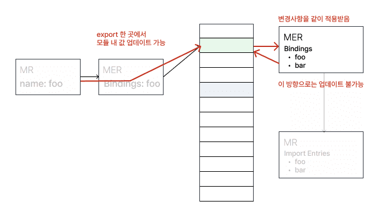
      - 그렇다면 commonJS에서는 Tree Shaking이 안되는 걸까요??
        - exports가 동적일 경우 빌드 단계에서 모듈 포함하기 어려움.

      ```tsx
          module.exports[localStorage.getItem(Math.random())] = () => { … };
      ```

## [미사용 의존성 패키지 제거](https://seungahhong.github.io/blog/2024/03/2024-03-17-remove-unused-dependencies/)

# 빌드 속도 개선(with CRA)

CRA(with webpack)에 loader-plugin 방식을 그대로 사용하면서 빌드 성능을 높일 수 있는 esbuild-loader 를 통해서 빌드 속도 개선을 진행하였습니다.

## 빌드 속도 측정(speed-measure-webpack-plugin)


```tsx
yarn add -D speed-measure-webpack-plugin
```

속도를 측정해보자.
측정을 해보니 빌드 시간 느린 순으로**babel-loader(5분), Terser Plugin(2분), OptimizeCssAssetsWebpackPlugin(15초)** 정도가 오래 걸리는 다는 것을 확인 할 수 있었습니다.
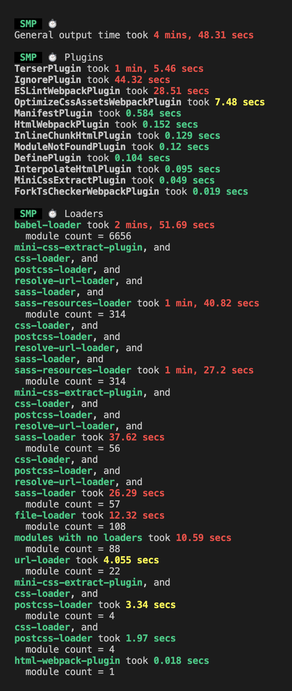

- 성능 측정에 대한 Loader, Plugin 정리
  - **babel-loader**
    - es6 이상의 문법을 es5 이하의 코드로 **transpiling** 해주는 것을 babel이라고 하며 이러한 babel과 webpack을 연동시켜주는 것이 babel-loader입니다.
  - **optimize-css-assets-webpack-plugin**
    - HtmlWebpackPlugin 이 html을 압축하는 plugin이라면, optimize-css-assets-webpack-plugin는 css를 압축시키는 plugin입니다.
  - **terser-webpack-plugin**
    - 코드를 mangle 하는 과정이나 compress 하는 과정과 같이, 우리가 작성한 코드를 동일한 기능을 제공하는 경량화된 코드로 변환해 주는 일련의 작업을 minify 혹은 minification(코드 경량화) 라고 부르고, 코드 경량화 작업을 해주는 툴을 우리는 minifier라고 합니다. terser-webpack-plugin은는 우리가 작성한 자바스크립트 코드를 프로덕션에서 더욱 경량화된 상태로 제공될 수 있도록 도와주는 plugin 입니다.
  - **css-loader, postcss-loader, sass-loader**
    - **postcss-loader**: js 플러그인을 통해 스타일을 변형하는 도구입니다.
    - **sass-loader**: sass-loader는 webpack에 의해 관리 및 유지되는 기능이 아닌 third-party 패키지로, 브라우저는 sass를 인식할 수 없기 때문에 css로 **transpiling** 해줍니다.
    - **css-loader**: css 파일을 js 코드로 변환합니다.
  - **IgnorePlugin**
    - 번들링시 무시할 파일들을 정규 표현식 또는 필터 함수로 설정합니다.
  - **file-loader**: 파일을 모듈로 사용할 수 있게 만들어주는 처리를 합니다. 실제로 사용하는 파일을 output directory로 옮깁니다.
  - **url-loader**: 파일을 base64 url로 변환하는 처리를 해줍니다. 파일을 옮기는 작업이 아닌 변환해서 output directory에 저장합니다.

## babel-loader vs ts-loader vs esbuild-loader 중 어떤게 더 좋을까?? → esbuild-loader 선택

- babel-loader vs ts-loader vs esbuild-loader 비교

  - type 체킹을 위해서 fork-ts-checker-webpack-plugin 추가 후 테스트
  - babel-loader, esbuild-loader → Running tsc --noEmit command 체킹 가능
  - 빌드 시간

    - babel-loader: 19초
    - ts-loader: 17초 (2초👇)
    - esbuild-loader: 14초 (5초👇)

      (참고: [victor 블로그](https://victor-log.vercel.app/post/build-speed-optimization-with-loader/))

- babel-loader + terser minify vs esbuild-loader + esbuild-minify 비교

  (참고 : [카카오엔터 블로그](https://fe-developers.kakaoent.com/2022/220707-webpack-esbuild-loader/))

  - Dev Server: 3399.80ms → 2031.40ms **(1.3s 👇)**
  - HMR: 199.20ms → 102.00ms **(97ms 👇)**
  - Production Build: 5617.40ms → 2238.20ms **(3.3s 👇)**
    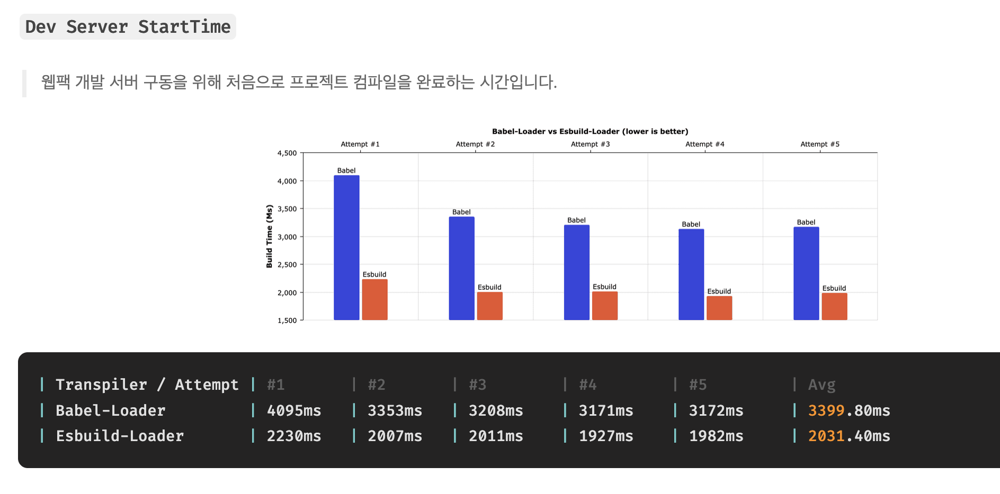
    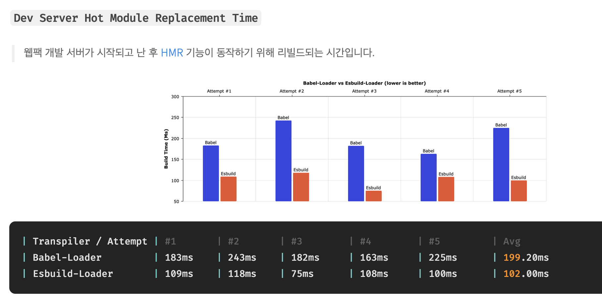
    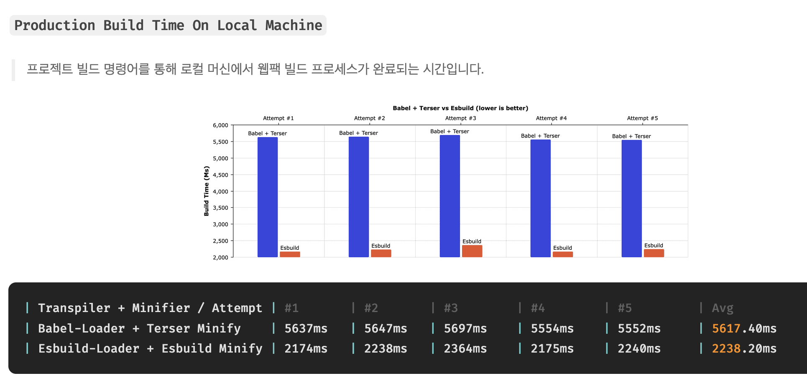

- ts-loader vs esbuild-loader 비교
  ts-loader vs esbuild-loader

  ( 참고 : [votogeter 블로그](https://velog.io/@votogether2023/ts-loader%EB%A5%BC-esbuild-loader%EB%A1%9C-%EB%A7%88%EC%9D%B4%EA%B7%B8%EB%A0%88%EC%9D%B4%EC%85%98%ED%95%B4%EB%B3%B4%EC%9E%90) )

- speed-measure-plugin 설치: 23s → 4s **(19s👇)**
  - ts-loader
    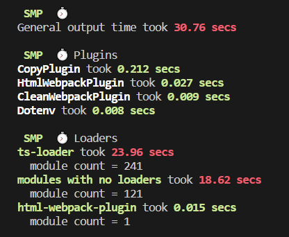
  - esbuild-loader
    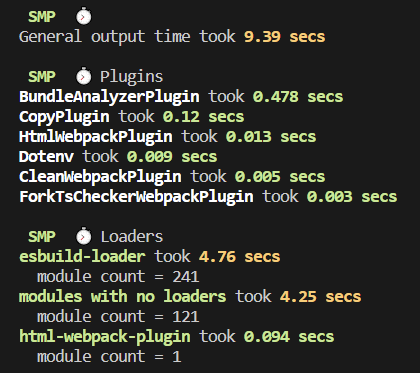
- production build: 2분 → 1분 **( 1분👇)**
  - ts-loader
    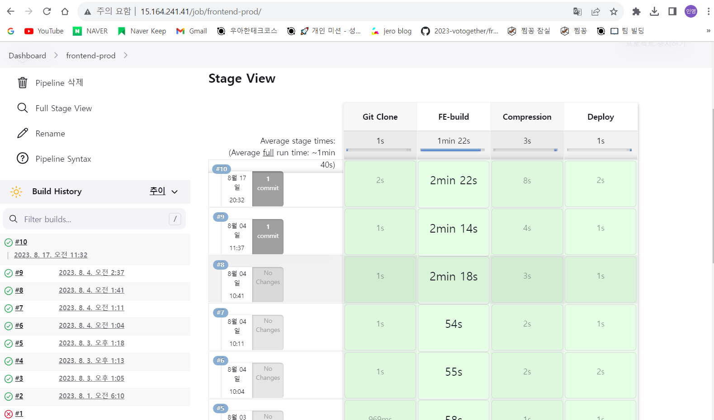
  - esbuild-loader
    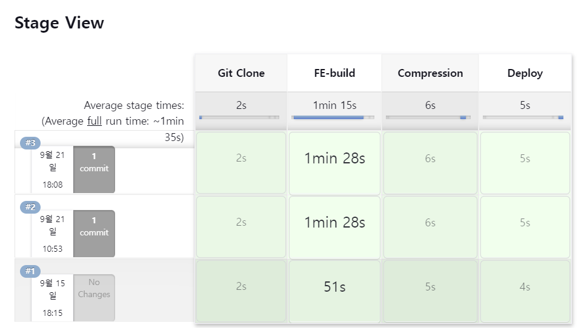

## esbuild-loader 설명 전 번들러 대한 설명

번들러 정의
웹 애플리케이션을 구성하는 모듈, 자원(HTML, CSS, Javascript, Image 등)을 모아 조합하여 하나의 결과물을 만드는 도구 입니다.
기대하는 역할

- 모듈러
- 트랜스파일러
- 난독화/압축
- 그외 최적화 기능 ( 모듈 분할, 트리 쉐이킹 )
  번들러 종류
  
- **Webapck - 2014**
  - **개발 편의 기능을 제공하는 정적 모듈 번들러**
  - **규모가 크고 복잡한 애플리케이션 관리 집중**
  - Tree-Shaking, code-spliting, HMR 기능 제공
  - v4 <= commonjs인 cjs 포맷만을 지원, v5( esmodule 포멧 지원)
- **Rollup - 2015**
  - **경량화와 번들 최적화를 중점에 둔 esm 지원 모듈 번들러**
  - **esmodule 지원을 통한 모듈간 의존성 파악 명확 → 강력한 Tree-shaking 제공**
  - Tree-Shaking, code-spliting, HMR(rollup-plugin-hot) 기능 제공
- **Parcel, zero-configuration - 2016**
  - webpack과 Rollup와 같은 복잡한 설정 없이 바로 사용할 수 있는 번들러
  - 세밀한 최적화나 커스터마이징에 한계
  - **중소 프로젝트에 적합한 번들러**
- **esbuild, 100배 빠른 번들러의 등장 - 2020**
  - **컴파일 언어인 Go로 구현**
  - **병렬처리 작업**
  - **CPU 캐시 적극 사용**
  - **단, 미지원 기능들이 다수 존재**
- **Snowpack - 2019**
  - 개발 서버에 중점, 전체 파일 번들링 하지 않는 개발(Unbundled Development) → esbuild 사용
  - **변경된 파일을 다시 빌드하고, 전체 파일에 대한 번들링 X**
  - **프로덕션 빌드 → 웹팩, 롤업 번들러 선택**
  - 단, 2021.1월에 지원 종료 선언 → vite 사용 권고
    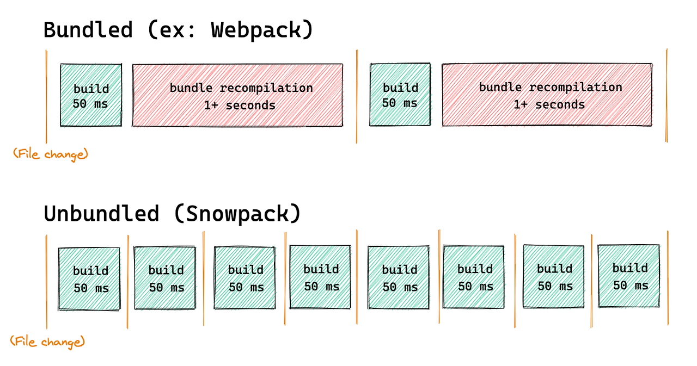
- **Vite - 2020**
  - **ESM을 이용한 개발서버와 Rollup 최적화 빌드 커맨드를 제공하는 프론트엔드 빌드 툴**
    - dev 환경: esbuild
    - production 환경: rollup
  - **변경된 파일을 다시 빌드하고, 전체 파일에 대한 번들링 X**
  - Snowpack → vite 선택 이유: 빌드 과정에서 단일 rollup 번들러 구성함에 따른 밀도 높은 통합, 간소화된 경험 제공
    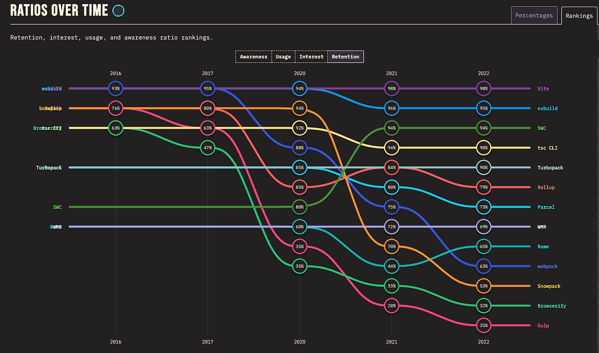
- **Webpack V5 - 2020**
  - **영구 캐싱으로 빌드 성능 개선**
  - 더 나은 알고리즘과 default설정으로 long term캐싱 개선
  - Tree shaking과 webpack build시 기본적으로 생성되는 default code에 대한 개선으로 번들 사이즈 개선
  - 웹 플랫폼과의 호환성 향상
  - 내부 구조 정리
  - **Module Federation → micro frontend Architecture 지원 → FE팀 모노레포 구조랑 상이**
    - 여러 서버에 배포되어 있는 모듈을 로딩할 수 있는 기능
      
- **Turbopack, Vite보다 5배 빠른 Rust 기반 Webpack 후속 번들러 등장 - 2022**
  - Rust로 작성
  - 지연 번들
  - Vite와 달리 모듈별 네이티브 브라우저 방식을 쓰지 않음
  - 콜드스타트가 대규모 어플에서도 빠름
  - Beta 버전

## [esbuild, esbuild-loader 설명](https://seungahhong.github.io/blog/2024/04/2024-04-28-esbuild/)

# 패키지 설치, 용량 속도 개선

npm, yarn classic 패키지 매니저에서 패키지 성능 개선을 위해서 pnpm 패키지 매니저를 선정해서 개선 진행하였습니다.

## pnpm 설명 전 패키지 매니저에 대한 설명

**npm( 2010년 1월 )**

- pkgmakeinst 약자 + node version → npm
- package.json, dependencies → node_modules 설치
- 커스텀 스크립트, public & private 패키지 레지스트리 개념 제공
  **yarn classic ( yarn 1.x, 2016년 )**
- npm 의 일관성, 보안, 성능 이슈 해결을 위한 패키지 매니저 추가(Yet Another Resource Negotiator 약자)
- native 모노레포 지원, cache-aware 설치
- 오프라인 캐싱, lock files
- 2020년 유지보수 모드 → yarn berry 개발 및 개선
  **npm, yarn classic → dependencies의 중복 저장, 호이스팅을 통한 유령 의존성 발생**
  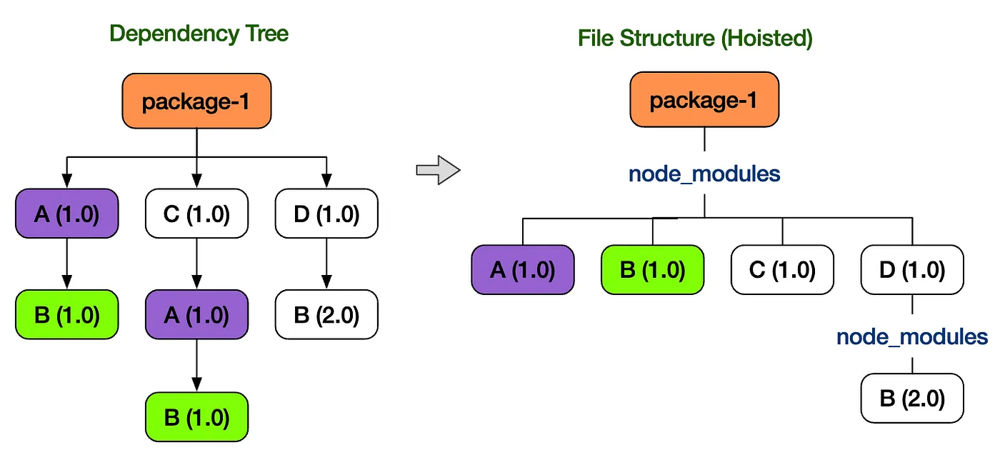
  **yarn berry, plug n play (2020년 1월)**
- Zero Install → PnP 방식
  - flat 하게 패키지 정리 (유령 의존성 X)
  - node_modules 패키지를 설치하지 않고 Zip Archive File로 관리
  - 설치할 때보다는 Zip 파일로 관리해서 용량 줄일 수 있는 장점
    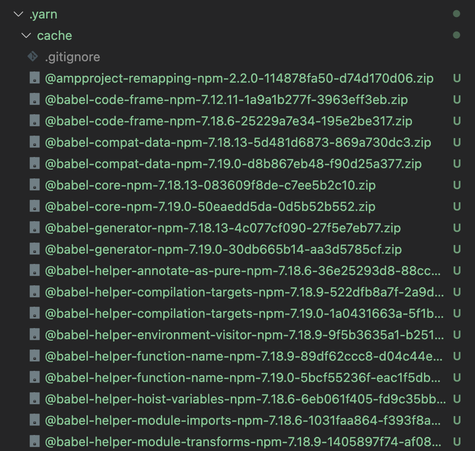
- 3가지 정도의 단점도 존재한다고 하네요ㅜㅜ
  - 성능 이슈 → yarn classic 환경 위에서 pnp 방식에 환경을 다시 돌리는 방식이다보니 기적적으로 성능이 빨라지지 않음
  - 모든 Dependency들을 zip 파일로 관리 불가능
    - 현재 환경에 대한 바이너리 정보를 가지고 동작해야 하는 Dependency → _swc, esbuild, sentry-cli_ 패키지는 shell 과 맞물려 있다보니 unplugged에서 관리
      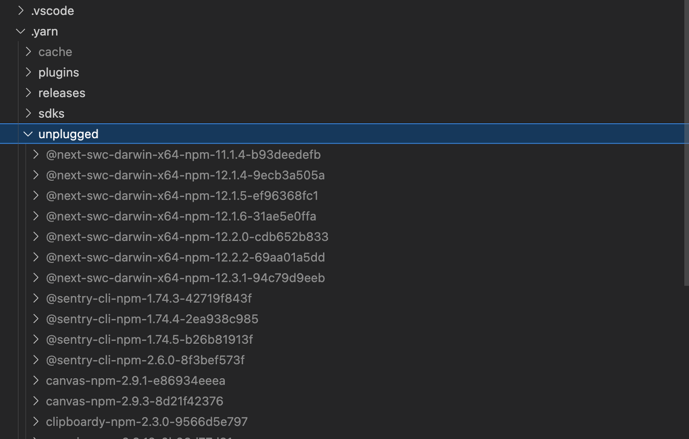
  - zip 파일들을 전체를 형상관리로 들고 다니기 너무 무겁다. - 압축 파일이라고 해도 dependency 사이즈가 크다보니 관리 어려움 - Dependency 업데이트 시 change Files 갯수가 많아짐
    **pnpm (2017년)**
- 빠르고 효율적인 디스크 관리
  - 글로벌 저장소 설치 → symbol link, hard link 연결
  - flat 하게 패키지 정리 (유령 의존성 X)
    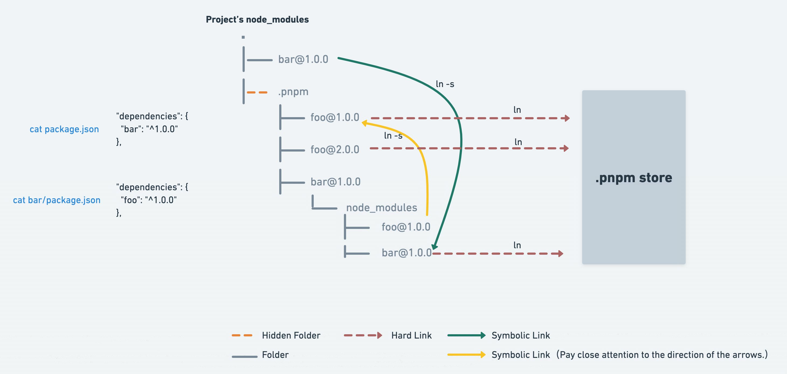

## [pnpm 설명](https://seungahhong.github.io/blog/2024/03/2024-03-18-pnpm/)

## pnpm 선정하게 된 이유

- npm, yarn classic 패키지 매니저 외에 더 좋은 선택지는 yarn berry, pnpm 입니다.
- pnpm 선정하게 된 이유
  - 글로벌 스토어에 패키지를 정하하고 symbolic, hard link통한 패키지를 연결한다면 초기 빌드 이후에는 설치 속도가 빨라질 수 있습니다.
  - node_modules에 패키지를 flat하게 관리하고 hoisting을 통한 패키지 끌어올림 처리를 하지 않기 때문에 package.json에 추가되지 않는 패키지는 node_modules 1 depth에 설치되지 않음으로 유령 의존성 해결이 가능합니다.
- yarn berry 선택하지 않는 이유
  - zip 파일로 관리하더라도 바이너리 환경에 맞물리는 패키지가 있었다면 zero install 불가능합니다.
  - 패키지를 형상 관리로 관리할 경우에 패키지 설치/삭제/수정 시 너무 많은 변경사항 파악이 어렵습니다.

# 빌드 도구 개선(CRA → Vite)

## Vite 선정하게 된 이유

- 콜드 스타트 방식의 개발 서버 구동에 대한 성능 개선 → node_modules 사전 빌드(esbuild)
- HMR 성능 개선 → esm 방식을 통한 변경된 파일 교체
- 프로덕션 빌드 → rollup 번들러 사용(TreeShaking, 지연로딩, 파일 분할등의 다수 이점 제공)
  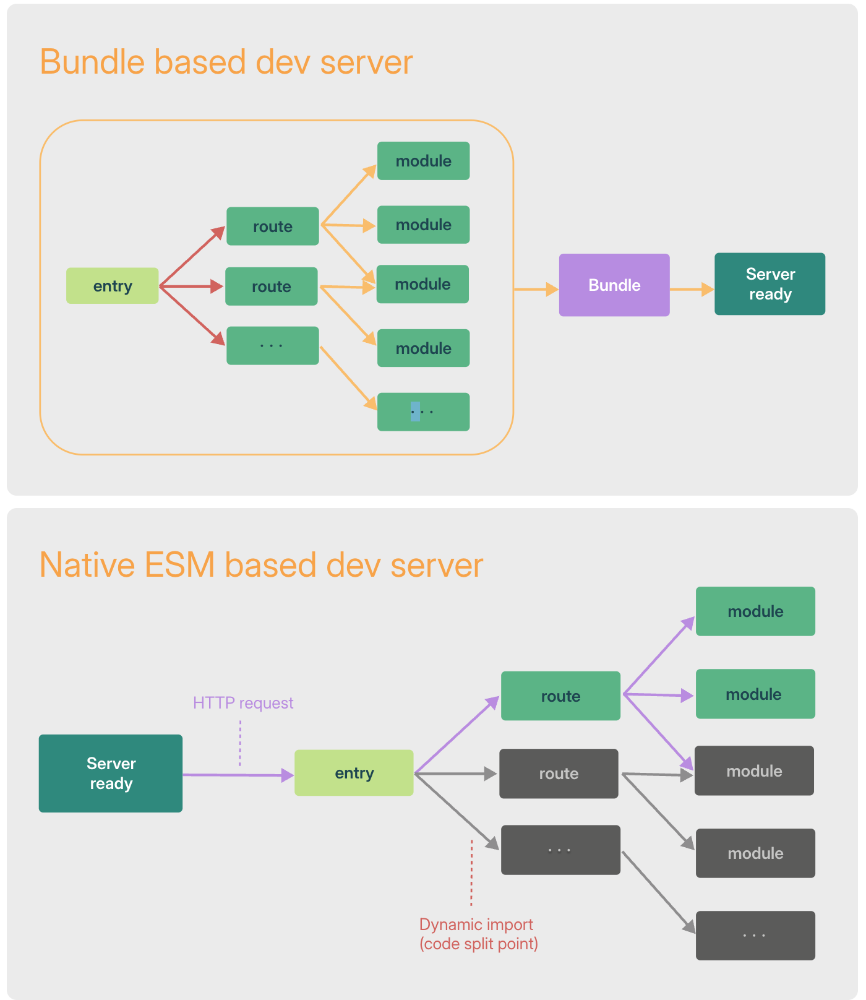

## [vite 설명](https://seungahhong.github.io/blog/2024/05/2024-05-06-vite/)

# 참고페이지

- [모듈 소개](https://ko.javascript.info/modules-intro)

- [Tree Shaking과 Module System](https://so-so.dev/web/tree-shaking-module-system/)

- [Webpack 빌드에 날개를 달아줄 Esbuild-Loader | 카카오엔터테인먼트 FE 기술블로그](https://fe-developers.kakaoent.com/2022/220707-webpack-esbuild-loader/)

- [개발자 경험 개선하기 (2) - ts-loader를 esbuild-loader로 마이그레이션해보자!](https://velog.io/@votogether2023/ts-loader를-esbuild-loader로-마이그레이션해보자)

- [Victor Log | 빌드 속도 최적화 with loader](https://victor-log.vercel.app/post/build-speed-optimization-with-loader/)

- [pnpm](https://jeonghwan-kim.github.io/2023/10/20/pnpm)

- [npm, yarn, pnpm 비교해보기](https://yceffort.kr/2022/05/npm-vs-yarn-vs-pnpm)

- [[Yarn berry] Yarn Berry의 문제점](https://helloinyong.tistory.com/m/344?utm_source=oneoneone)

- [Webpack 5, 무엇이 달라졌을까?](https://so-so.dev/tool/webpack/whats-different-in-webpack5/)

- [Webpack Module Federation 도입 전에 알아야 할 것들 | 카카오엔터테인먼트 FE 기술블로그](https://fe-developers.kakaoent.com/2022/220623-webpack-module-federation/)
